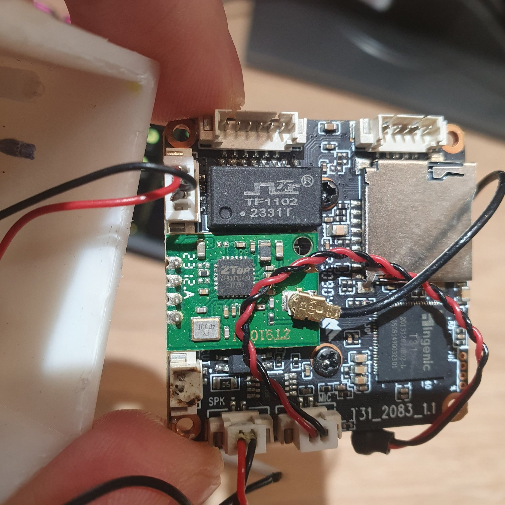

# CamHi / HiChip IP camera — audio to the camera speaker, no firmware changes

**Send a message, TTS or any WAV to the speaker of a CamHi Pro / HiChip (Ingenic
T31) IP camera over the network.** No firmware modification, no root, no cloud,
no vendor app. Standard library only.

[Русский](#русский) · [English](#english)

---

<a name="русский"></a>
# Русский

## Что это

Утилиты, которые **проигрывают звук на динамике** IP-камеры CamHi / HiChip
(Ingenic T31) прямо с компьютера. Плюс полный разбор протокола, добытый
реверс-инжинирингом прошивки.

**Проверено** на двух камерах `C6F0SgZ3N0PlL2`, прошивка `V25.1.3.16.3-20230628`,
веб `V3.0.7.1` — в том числе на камере **прямо из коробки**, которую никто не
трогал. Прошивка не изменялась, root не использовался.

## Как это работает

Камера запускает веб-сервер **Mongoose** на порту 80 и регистрирует в нём
медиа-разветвитель `HI_Media_Interface`. Тот маршрутизирует запросы по подстроке:

| подстрока в запросе | обработчик |
|---|---|
| `livestream/` | `HI_Media_LiveStreamParseStream` (видео) |
| `livestream.cgi` | `HI_Media_LiveStreamParseStreamEx` (видео) |
| **`call_invite.cgi`** | **`HI_Media_LiveStreamParseTalkEx` (двусторонний звук)** |

То есть у камеры есть **собственный HTTP-talk**: обычный Basic-auth, порт 80,
никакого P2P и никакого шифрования.

```
1. GET /call_invite.cgi?chn=1&type=g711a&     (Basic auth)
      -> 200 OK + дескриптор сессии (Session-ID, AEnc-Format, Audio-Port)

2. POST http://<cam>/call_invite.cgi?sessid=<Session-ID> HTTP/1.1
      -> камера входит в цикл приёма звука

3. аудиокадры: 20 байт заголовка + G.711 A-law
      [2:4]  BE u16 = 16 + длина полезной нагрузки
      [8:12] BE u32 метка времени
      [20:]  G.711 A-law, 8 кГц моно
```

Подробный разбор, адреса функций и дизассемблер — в
[`docs/PROTOCOL.md`](docs/PROTOCOL.md).

## Железо



SoC **Ingenic T31**, плата `T31_2083_1.1`, аудиочип `ZT810`, разъёмы `SPK` и
`MIC`, флеш `FS25Q064F2TFI1` (8 МБ). **Громкость динамика** задаётся в
веб-интерфейсе камеры: `Settings → Media → Audio` (CGI `setaudiooutvolume`
на этой прошивке не работает).

Фотографии и подробности — в [`docs/HARDWARE.md`](docs/HARDWARE.md).

## Что нужно

* Python **3.9+** (используется только стандартная библиотека, ставить нечего)
* Сетевая доступность камеры (порт 80)
* **Пароль администратора камеры** (тот же, что для веб-интерфейса и RTSP)
* Windows / Linux / macOS

## Быстрый старт

```bash
git clone https://github.com/<USER>/camhi-http-talk.git
cd camhi-http-talk

# пароль можно задать переменной окружения, чтобы не писать его в команде
export CAMHI_CAMERA=192.168.1.129          # Windows: set CAMHI_CAMERA=...
export CAMHI_PASSWORD='ваш-пароль'         # Windows: set CAMHI_PASSWORD=...

# проверка: 5 секунд тона 1000 Гц
python src/camhi_speaker_http.py --tone 5 --freq 1000

# проиграть WAV
python src/camhi_speaker_http.py --wav message.wav
```

Без переменных окружения — теми же значениями в аргументах:

```bash
python src/camhi_speaker_http.py --cam 192.168.1.129 --pwd 'ваш-пароль' --wav message.wav
```

## Сказать фразу голосом (Windows)

Скрипт синтезирует речь через SAPI и сразу отправляет её на камеру:

```powershell
python src/camhi_tts.py --cam 192.168.1.129 --pwd 'ваш-пароль' "Кто-то у двери"
python src/camhi_tts.py --list-voices          # доступные голоса
```

## Громкость

```bash
python src/camhi_speaker_http.py --wav message.wav --volume 150
```

`--volume` — **программное усиление**: `100` = без изменений, `0` = тишина,
`>100` = громче (до 400). Конфигурация камеры при этом **не трогается**
(CGI камеры `setaudiooutvolume` на этой прошивке не работает — отвечает
«set ok», но значение не меняется; уровень меняется только через веб-интерфейс).

## Home Assistant

```yaml
# configuration.yaml
shell_command:
  camhi_say: >-
    python3 /config/camhi/src/camhi_speaker_http.py
    --cam 192.168.1.129 --wav {{ wav }}
```

```yaml
# automation: сказать при обнаружении движения
automation:
  - alias: "Камера: предупреждение"
    trigger:
      - platform: state
        entity_id: binary_sensor.camera_motion
        to: "on"
    action:
      - service: shell_command.camhi_say
        data:
          wav: /config/sounds/attention.wav
```

Готовый пример — [`examples/home-assistant/`](examples/home-assistant/).

## Проверка камеры

```bash
python src/verify_camera.py --cam 192.168.1.129 --tone 0    # только рукопожатие
python src/verify_camera.py --cam 192.168.1.129 --tone 3    # с проверкой звука
```

Скрипт печатает модель, прошивку, какие кодеки согласуются, состояние P2P —
и **ничего не записывает в камеру**.

## Параметры

| Параметр | Значение |
|---|---|
| `--cam IP` | адрес камеры (или `CAMHI_CAMERA`) |
| `--pwd СТРОКА` | пароль администратора (или `CAMHI_PASSWORD`) |
| `--user ЛОГИН` | по умолчанию `admin` |
| `--wav ФАЙЛ` | проиграть WAV (16-бит PCM; любой формат, будет пересэмплирован) |
| `--tone СЕК` | проиграть тон |
| `--freq ГЦ` | частота тона, по умолчанию 1000 |
| `--volume 0-400` | программное усиление |
| `--frame-ms 20\|100` | размер аудиокадра |
| `--lead-ms N` | предбуфер (по умолчанию 400 мс) |
| `--reset-ao` | перевключить аудиовыход (лечит «залипшую» тишину) |
| `--get-volume` | показать громкость, которую сообщает камера |
| `--retries N` | повторы, пока камера занята |

## Если что-то не работает

| Симптом | Причина и решение |
|---|---|
| `401 Unauthorized` | неверный пароль. Это пароль от веб-интерфейса/RTSP |
| `(no reply)` | камера ещё завершает предыдущую сессию. Скрипт повторяет сам; увеличьте `--retries` |
| Тишина, но сессия открылась | аудиовыход «залип» в mute → `--reset-ao`. Если не помогло — перезагрузка камеры |
| Речь с щелчками | обычно железо динамика, либо слишком большой `--volume` (клиппует) |
| Звук «медленный» | камера не успевает: уменьшите `--volume`, проверьте загрузку сети |
| Тон слышен, речь нет / очень тихо | громкость **самой камеры** низкая (в веб-интерфейсе может стоять 5 из 100). Поднимите её в веб-интерфейсе **или** компенсируйте программно: `--volume 300` (`--get-volume` покажет текущее значение) |
| Речь не слышна совсем | проверьте WAV: нужен 16-бит PCM; скрипт сам пересэмплирует и сведёт в моно |

## Чего этот проект НЕ делает

* **Не перепрошивает камеру** и не требует root.
* **Не работает через облако** — только локальная сеть.
* **Не поднимает P2P на произвольной камере.** P2P-логин камеры привязан к её
  UID (ключ = `MD5(handleField + пароль + UID + логин)`), поэтому сохранённый
  пакет логина годится только для той камеры, с которой снят. Подробности и
  альтернативы — в [`docs/P2P.md`](docs/P2P.md).
* **Не отправляет G.726 и AAC.** Камера согласует их и рапортует в дескрипторе,
  но декодера этих кодеков у неё нет — звук всегда декодируется как G.711 A-law.
  Полезная нагрузка обязана быть A-law.

## Правовая заметка

Проект предназначен для **своих собственных камер** в **своей собственной сети**.
Не запускайте его против устройств, которыми вы не владеете.

## Лицензия

MIT — см. [`LICENSE`](LICENSE).

---

<a name="english"></a>
# English

## What this is

Utilities that **play audio on the speaker** of a CamHi / HiChip (Ingenic T31) IP
camera straight from your computer, plus a full protocol write-up obtained by
reverse-engineering the firmware.

**Verified** on two `C6F0SgZ3N0PlL2` cameras, firmware `V25.1.3.16.3-20230628`,
web `V3.0.7.1` — including one **straight out of the box** that had never been
touched. The firmware was not modified and root was not used.

## How it works

The camera runs a **Mongoose** web server on port 80 and registers a media
distributor (`HI_Media_Interface`) with it. It routes requests by substring:

| request substring | handler |
|---|---|
| `livestream/` | `HI_Media_LiveStreamParseStream` (video) |
| `livestream.cgi` | `HI_Media_LiveStreamParseStreamEx` (video) |
| **`call_invite.cgi`** | **`HI_Media_LiveStreamParseTalkEx` (two-way audio)** |

So the camera ships its **own HTTP talk endpoint**: plain Basic auth, port 80,
no P2P and no encryption.

```
1. GET /call_invite.cgi?chn=1&type=g711a&     (Basic auth)
      -> 200 OK + session descriptor (Session-ID, AEnc-Format, Audio-Port)

2. POST http://<cam>/call_invite.cgi?sessid=<Session-ID> HTTP/1.1
      -> the camera enters its audio receive loop

3. audio frames: 20-byte header + G.711 A-law
      [2:4]  BE u16 = 16 + payload length
      [8:12] BE u32 timestamp
      [20:]  G.711 A-law, 8 kHz mono
```

Full details, function addresses and disassembly: [`docs/PROTOCOL.md`](docs/PROTOCOL.md).

## Hardware


**Ingenic T31** SoC, board `T31_2083_1.1`, `ZT810` audio chip, `SPK` and `MIC`
connectors, `FS25Q064F2TFI1` flash (8 MB). The **speaker volume** is set in the
camera's web UI: `Settings → Media → Audio` (the `setaudiooutvolume` CGI does not
work on this firmware).

Photos and details: [`docs/HARDWARE.md`](docs/HARDWARE.md).

## Requirements

* Python **3.9+** (standard library only — nothing to install)
* Network access to the camera (port 80)
* The camera's **admin password** (same one used by the web UI and RTSP)
* Windows / Linux / macOS

## Quick start

```bash
git clone https://github.com/<USER>/camhi-http-talk.git
cd camhi-http-talk

export CAMHI_CAMERA=192.168.1.129
export CAMHI_PASSWORD='your-password'

# smoke test: 5 seconds of a 1 kHz tone
python src/camhi_speaker_http.py --tone 5 --freq 1000

# play a WAV
python src/camhi_speaker_http.py --wav message.wav
```

Or pass everything explicitly:

```bash
python src/camhi_speaker_http.py --cam 192.168.1.129 --pwd 'your-password' --wav message.wav
```

## Speak a phrase (Windows)

```powershell
python src/camhi_tts.py --cam 192.168.1.129 --pwd 'your-password' "Someone is at the door"
python src/camhi_tts.py --list-voices
```

## Volume

```bash
python src/camhi_speaker_http.py --wav message.wav --volume 150
```

`--volume` is **software gain**: `100` = unchanged, `0` = silence, `>100` = louder
(up to 400). The camera configuration is **never written** (the camera's
`setaudiooutvolume` CGI reports success but does not change the level on this
firmware; use the camera's web UI for that).

## Home Assistant

```yaml
shell_command:
  camhi_say: >-
    python3 /config/camhi/src/camhi_speaker_http.py
    --cam 192.168.1.129 --wav {{ wav }}
```

See [`examples/home-assistant/`](examples/home-assistant/) for a complete example.

## Camera check

```bash
python src/verify_camera.py --cam 192.168.1.129 --tone 0    # handshake only
python src/verify_camera.py --cam 192.168.1.129 --tone 3    # with audio
```

It prints model, firmware, which codecs negotiate and P2P state — and **writes
nothing to the camera**.

## Options

| Option | Meaning |
|---|---|
| `--cam IP` | camera address (or `CAMHI_CAMERA`) |
| `--pwd STRING` | admin password (or `CAMHI_PASSWORD`) |
| `--user LOGIN` | defaults to `admin` |
| `--wav FILE` | play a WAV (16-bit PCM; any rate, it is resampled) |
| `--tone SEC` | play a tone |
| `--freq HZ` | tone frequency, default 1000 |
| `--volume 0-400` | software gain |
| `--frame-ms 20\|100` | audio frame size |
| `--lead-ms N` | pre-buffer (default 400 ms) |
| `--reset-ao` | re-arm the audio output (cures a stuck mute) |
| `--get-volume` | print the volume the camera reports |
| `--retries N` | retries while the camera is busy |

## Troubleshooting

| Symptom | Cause / fix |
|---|---|
| `401 Unauthorized` | wrong password — it is the web UI / RTSP password |
| `(no reply)` | the camera is still ending the previous session; the client retries, raise `--retries` |
| Session opens but silence | audio output stuck muted → `--reset-ao`; if that fails, reboot the camera |
| Crackling speech | usually the speaker hardware, or `--volume` too high (clipping) |
| Audio sounds slow | the camera cannot keep up: lower `--volume`, check the network |
| Tone plays, speech does not / very quiet | the **camera's own** volume is low (the web UI may show 5 out of 100). Raise it in the web UI **or** compensate in software: `--volume 300` (`--get-volume` reports the current value) |
| No speech at all | check the WAV — needs 16-bit PCM; the script resamples and downmixes |

## What this project does NOT do

* **No firmware modification**, no root.
* **No cloud** — local network only.
* **No P2P on an arbitrary camera.** The P2P login is bound to the camera's UID
  (key = `MD5(handleField + password + UID + username)`), so a captured login
  packet only works on the camera it came from. See [`docs/P2P.md`](docs/P2P.md).
* **No G.726 or AAC.** The camera negotiates and advertises them, but has no
  decoder for either — audio is always decoded as G.711 A-law. The payload must
  be A-law.

## Legal note

This project is for **your own cameras**, on **your own network**. Do not run it
against devices you do not own.

## License

MIT — see [`LICENSE`](LICENSE).
