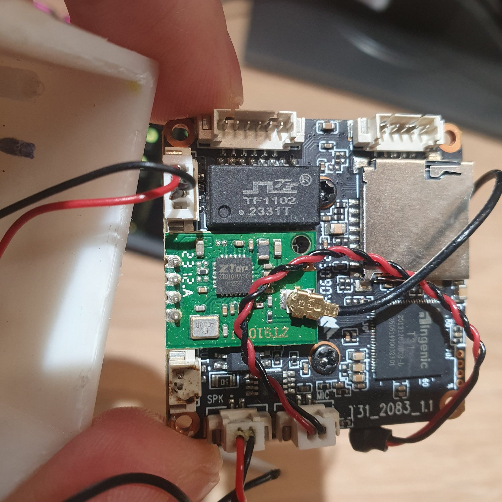
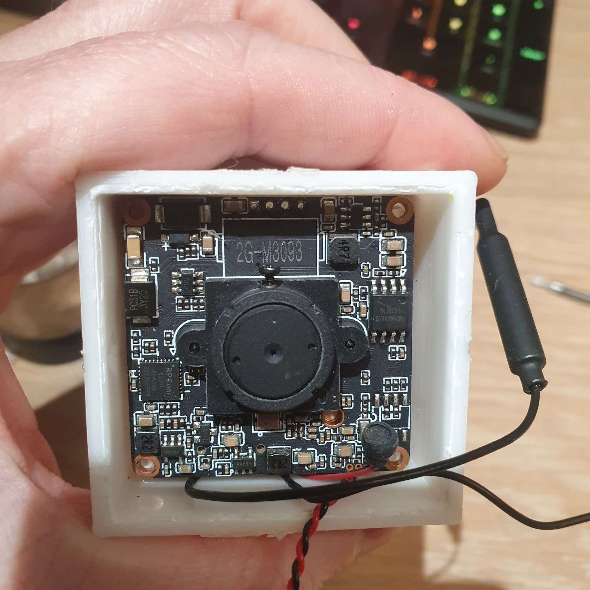
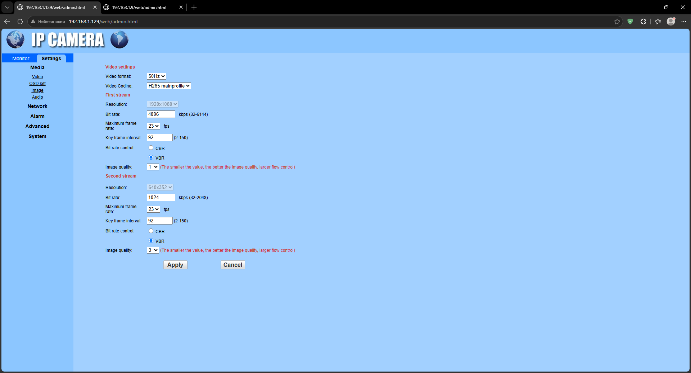

# Hardware

[Русский](#русский) · [English](#english)

CamHi Pro cube camera, model `C6F0SgZ3N0PlL2`, board `T31_2083_1.1`.

---

<a name="русский"></a>
# Русский

## Плата



*Плата со стороны компонентов. Видны SoC Ingenic T31, модуль TF1102, WiFi-модуль
ZT9101UV на зелёной плашке и разъёмы SPK / MIC.*

| Что | Обозначение | Примечание |
|---|---|---|
| SoC | **Ingenic T31** | MIPS32 XBurst — совпадает с тем, что дала прошивка |
| Плата | `T31_2083_1.1` | шелкография |
| Сетевой модуль | `TF1102 2331T` | согласующий трансформатор Ethernet |
| WiFi-модуль | `ZT9101UV` | на отдельной зелёной плашке |
| Флеш | `FM25Q64A13` | 8 МБ; U-Boot определяет её как `FS25Q064F2TFI1` |
| Разъёмы | `SPK`, `MIC` | динамик и микрофон |

**`SPK` — разъём динамика**



*Плата в корпусе, обратная сторона. Шелкография `2G-W3098`.*

## Веб-интерфейс



*`http://<камера>/web/admin.html` → Settings → Media.*

**Громкость динамика задаётся здесь**, в разделе **Media → Audio**.
Это важно: CGI `setaudiooutvolume` на этой прошивке **не работает** (камера
отвечает `[Succeed]set ok.`, но значение не меняется). Реальный уровень
меняется только через этот веб-интерфейс.

Если громкость в веб-интерфейсе низкая (например, 5 из 100), речь может быть
едва слышна — тогда компенсируйте программно:

```bash
python src/camhi_speaker_http.py --wav message.wav --volume 300
```

Проверить, что сообщает камера:

```bash
python src/camhi_speaker_http.py --get-volume
```

---

<a name="english"></a>
# English

## The board


*Component side. The Ingenic T31 SoC, the TF1102 module, the ZT9101UV WiFi module
on its own green daughter board, and the SPK / MIC connectors.*

| Item | Marking | Note |
|---|---|---|
| SoC | **Ingenic T31** | MIPS32 XBurst — matches the firmware analysis |
| Board | `T31_2083_1.1` | silkscreen |
| Network module | `TF1102 2331T` | Ethernet magnetics |
| WiFi module | `ZT9101UV` | on a separate green daughter board |
| Flash | `FM25Q64A13` | 8 MB; U-Boot reports it as `FS25Q064F2TFI1` |
| Connectors | `SPK`, `MIC` | speaker and microphone |

**`SPK` is the speaker connector**


*Board inside the housing, reverse side. Silkscreen `2G-W3098`.*

## The web UI


*`http://<camera>/web/admin.html` → Settings → Media.*

**The speaker volume is set here**, under **Media → Audio**.
This matters: the `setaudiooutvolume` CGI **does not work** on this firmware (the
camera answers `[Succeed]set ok.` but the value never changes). The real level can
only be changed from this web UI.

If the web UI volume is low (say 5 out of 100) speech may be barely audible —
compensate in software:

```bash
python src/camhi_speaker_http.py --wav message.wav --volume 300
```

Check what the camera reports:

```bash
python src/camhi_speaker_http.py --get-volume
```
